<div align="center">


# card.

**A digital business card you can create, share with a QR code, scan, and keep, all on your own phone.**

Flutter · Bloc/Cubit · SQLite · go_router · Firebase Auth (identity only) · Static web viewer

</div>

---

## Table of contents

1. [What is card.?](#1-what-is-card)
2. [Screenshots](#2-screenshots)
3. [Features](#3-features)
4. [How the whole idea works (no backend)](#4-how-the-whole-idea-works-no-backend)
5. [Tech stack and packages](#5-tech-stack-and-packages)
6. [Project structure](#6-project-structure)
7. [Architecture](#7-architecture)
8. [Data layer in depth](#8-data-layer-in-depth)
9. [The share link, step by step](#9-the-share-link-step-by-step)
10. [State management in depth](#10-state-management-in-depth)
11. [Navigation](#11-navigation)
12. [Feature walkthroughs](#12-feature-walkthroughs)
13. [Theming and design system](#13-theming-and-design-system)
14. [QR image export](#14-qr-image-export)
15. [Backup and restore](#15-backup-and-restore)
16. [Authentication](#16-authentication)
17. [The web viewer](#17-the-web-viewer)
18. [Setup and running](#18-setup-and-running)
19. [Android configuration](#19-android-configuration)
20. [App icon, splash and renaming](#20-app-icon-splash-and-renaming)
21. [Deploying the web viewer](#21-deploying-the-web-viewer)
22. [Privacy and security notes](#22-privacy-and-security-notes)
23. [Known limitations](#23-known-limitations)
24. [Roadmap](#24-roadmap)
25. [Troubleshooting / FAQ](#25-troubleshooting--faq)
26. [Coding conventions](#26-coding-conventions)
27. [Contributing](#27-contributing)
28. [Author and license](#28-author-and-license)
29. [ملخص بالعربي](#29-ملخص-بالعربي)

---

## 1. What is card.?

**card.** is a Linktree-style digital business card app. You build a card with your name, job, company, emails, phones and social links, pick a color and a pattern, and the app gives you:

- a **QR code** and a **short link** that contain the whole card,
- a **scanner** that reads someone else's QR and saves their card to your contacts,
- a **web page** that opens the link on any phone, even if the person doesn't have the app.

The key constraint of the project: **there is no server and no database in the cloud**. Everything about a card lives either on the phone (SQLite) or inside the link itself. That keeps the project free to run, private by default, and simple to maintain.

> The project was built as a graduation/scholarship project (NTI), so the architecture is deliberately clean and explainable rather than clever.

---

## 2. Screenshots

> Put the real images in `docs/screenshots/` with the file names below and they will show up automatically. Light and dark are both supported by the app, so capture both when you can.

### Onboarding and splash

|                        Splash                        |                        Onboarding 1                        |                        Onboarding 2                        |                        Onboarding 3                        |
| :--------------------------------------------------: | :--------------------------------------------------------: | :--------------------------------------------------------: | :--------------------------------------------------------: |
| 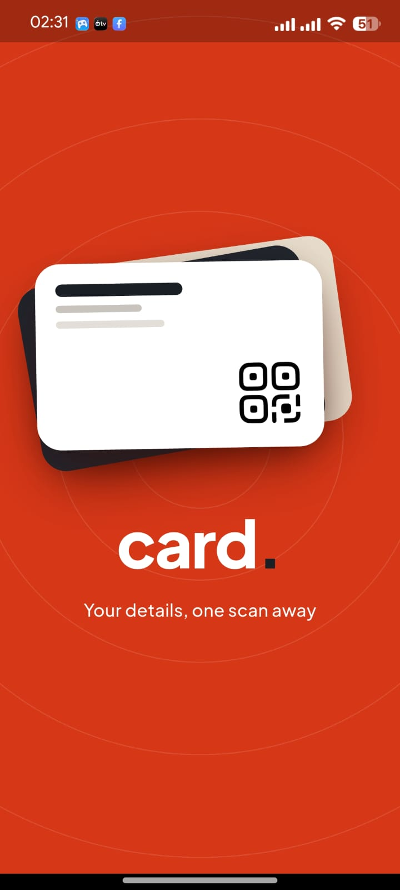 | 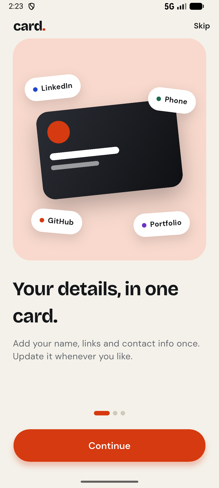 | 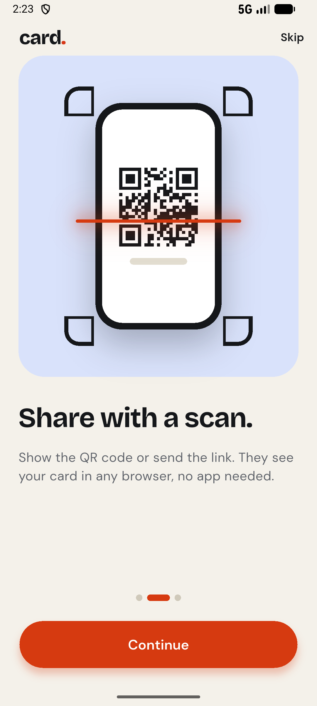 | 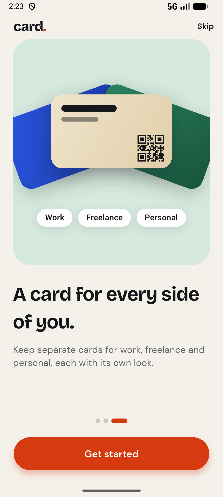 |

### Home, create and preview

|                     Home (no cards)                      |                       Home (cards)                       |                        Create card                        |                        Preview                        |
| :------------------------------------------------------: | :------------------------------------------------------: | :-------------------------------------------------------: | :---------------------------------------------------: |
| 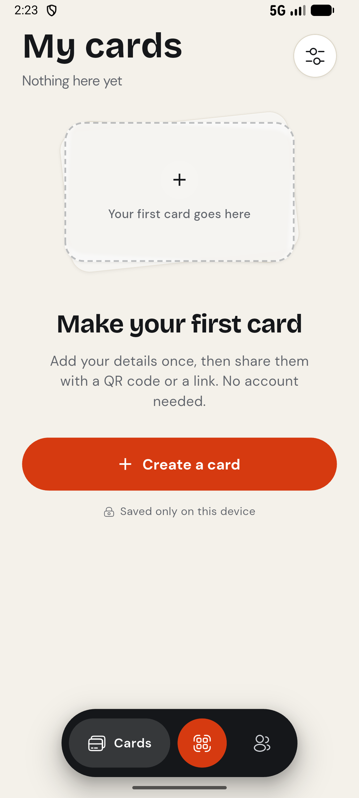 | 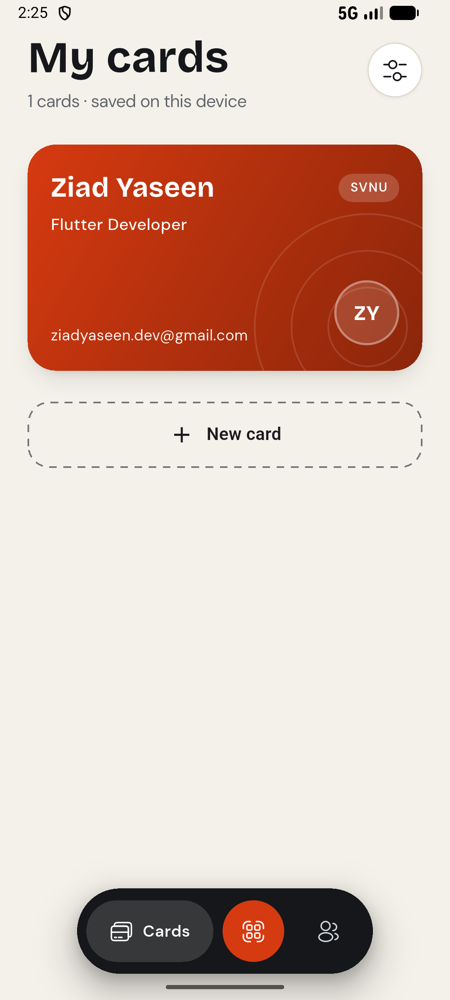 | 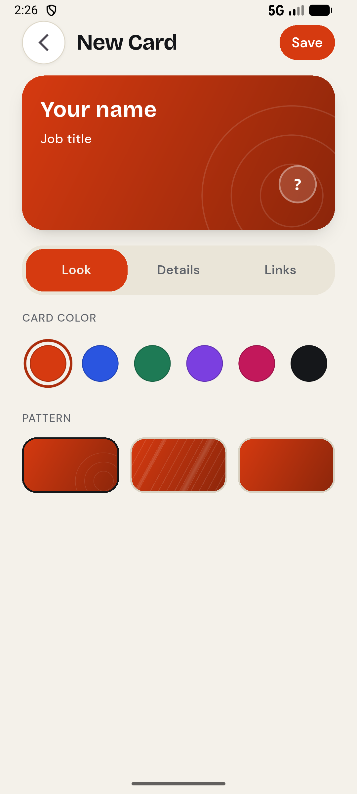 | 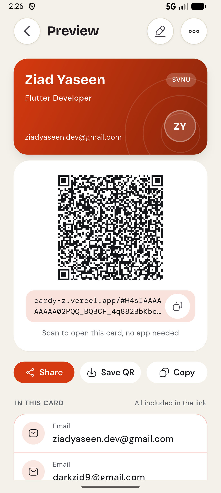 |

### Scan and contacts

|                        Scan                        |                       Scan result                        |                        Contacts                        |                        Contact preview                        |
| :------------------------------------------------: | :------------------------------------------------------: | :----------------------------------------------------: | :-----------------------------------------------------------: |
| 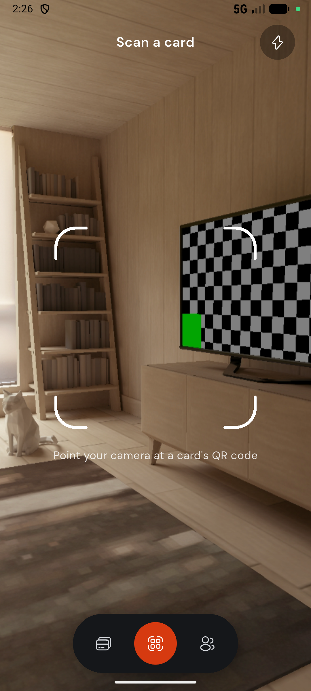 | 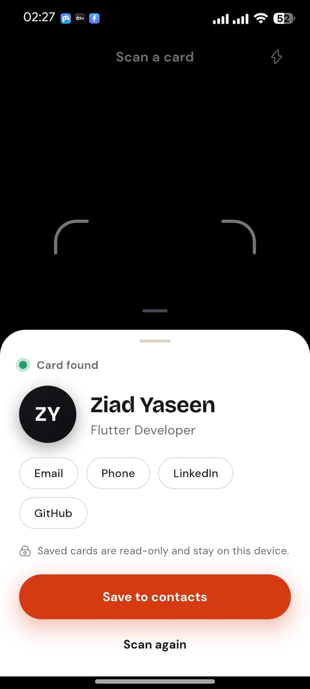 | 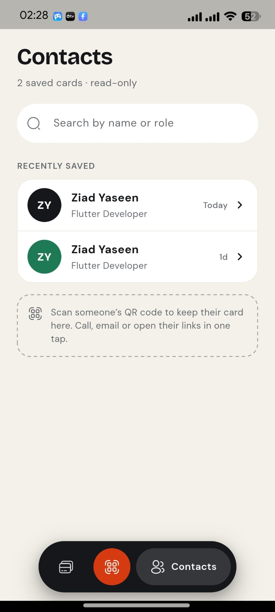 | 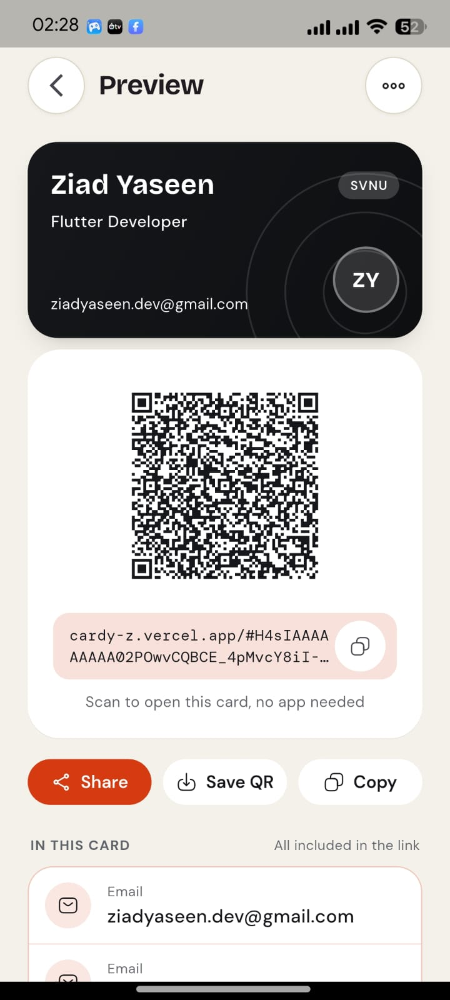 |

### Settings

|                            Appearance                             |                          Your data                          |                            Account                             |                      Sign in sheet                       |
| :---------------------------------------------------------------: | :---------------------------------------------------------: | :------------------------------------------------------------: | :------------------------------------------------------: |
| 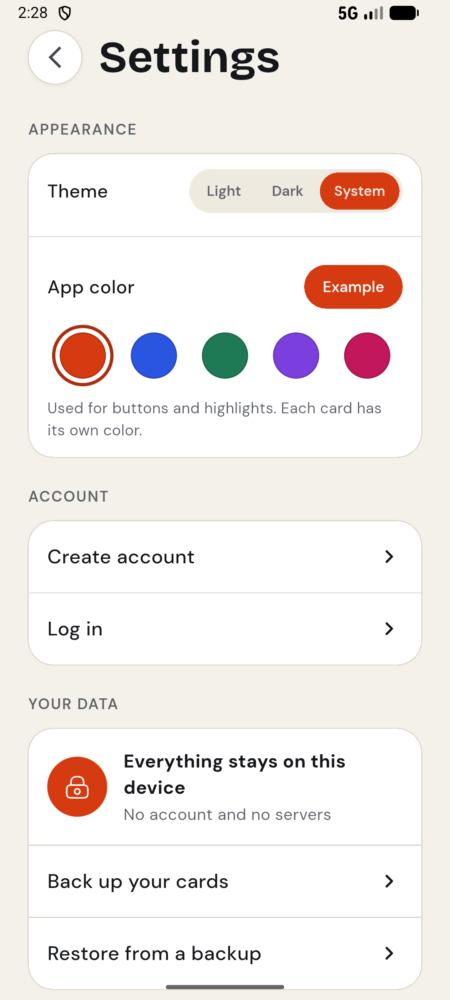 | 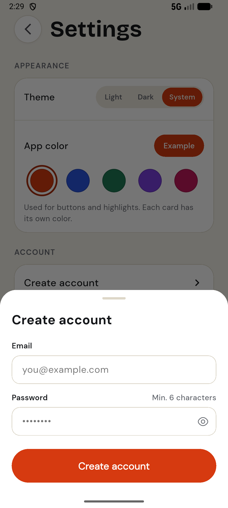 | 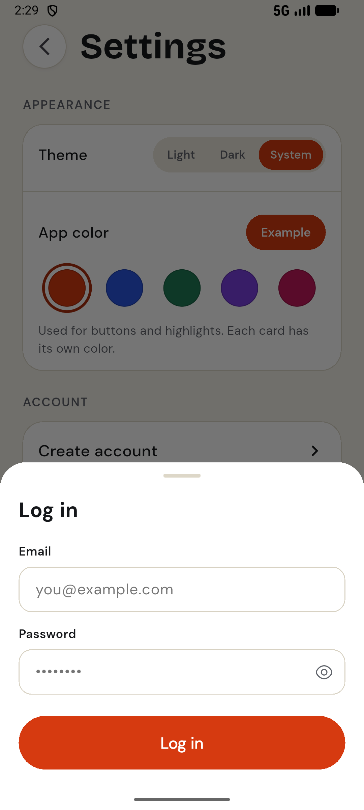 | 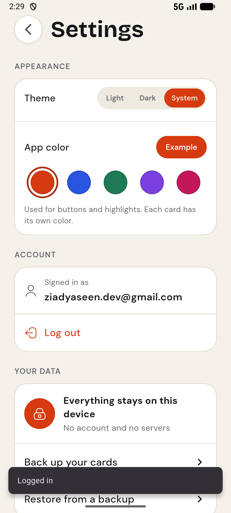 |

### Dark mode and themes

|                        Dark home                        |                        Dark preview                        |                        Ocean accent                        |                        Forest accent                        |
| :-----------------------------------------------------: | :--------------------------------------------------------: | :--------------------------------------------------------: | :---------------------------------------------------------: |
| 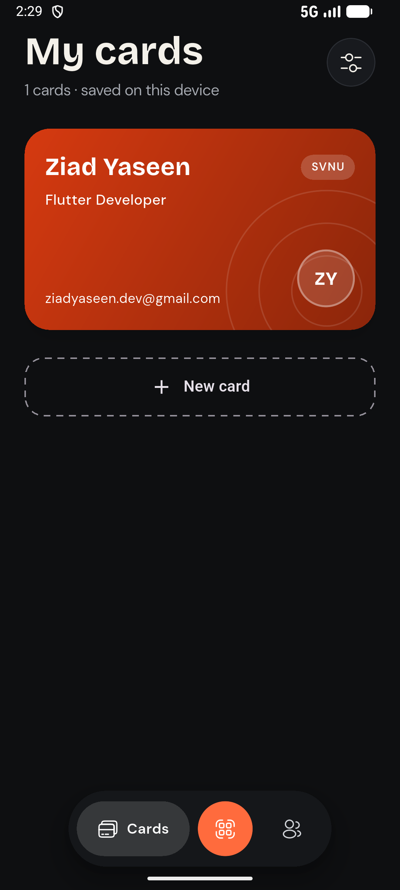 | 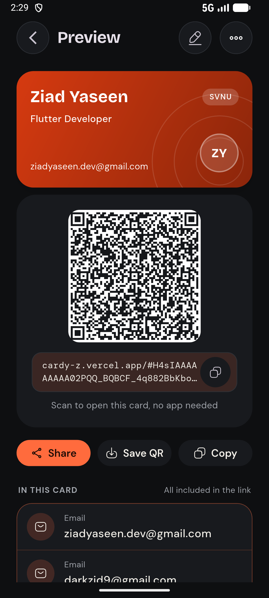 | 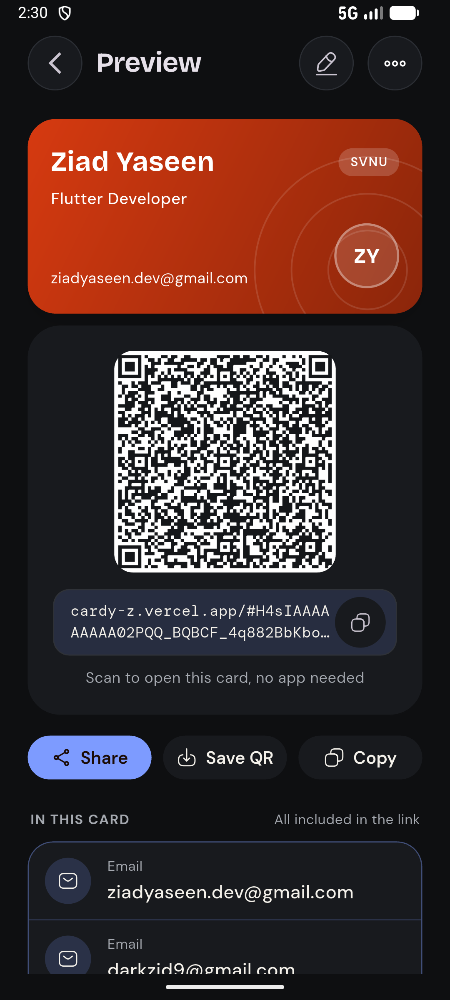 | 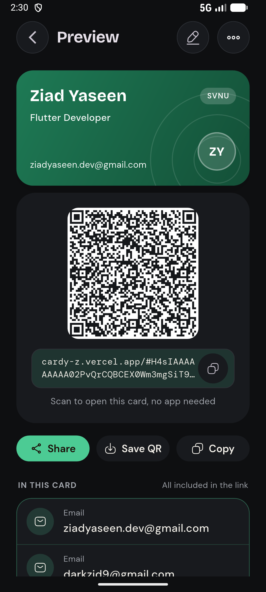 |

### The exported QR image

|             Saved QR (white rounded square)             |                        Web viewer                        |
| :-----------------------------------------------------: | :------------------------------------------------------: |
|  | 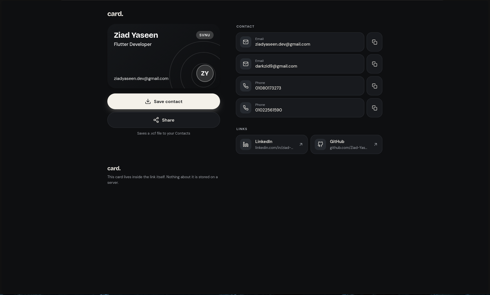 |

---

## 3. Features

### Cards

- Create unlimited personal cards.
- Fields: first, middle, last name, nickname, job title, company, multiple emails, multiple phones, LinkedIn, GitHub, portfolio, Instagram, Facebook, X, TikTok, and a free list of extra links.
- Six accent colors and three background patterns (`none`, `rings`, `stripes`).
- **Edit** an existing card (the pencil in the preview opens the create screen pre-filled and updates the same card instead of creating a new one).
- **Duplicate** and **delete** (with confirmation) from the menu in the preview.

### Sharing

- A QR code and a link generated from the card data.
- **Share**: sends the link and a ready-made QR image.
- **Save QR**: writes a PNG to `cards/my cards` on the phone.
- **Copy link**.

### Scanning and contacts

- Live camera scanner with a custom frame.
- Invalid QR codes get a friendly dialog instead of silent failure.
- A found card is shown in a bottom sheet and can be saved to contacts.
- The Contacts tab lists every saved card (not only recent ones), newest first.
- Opening a contact uses the same preview screen; the **edit button is hidden** for cards that aren't yours.
- Tap an email, phone number or link in the preview to open the mail app, the dialer, or the browser.

### Data

- Everything is stored locally in SQLite.
- One-tap **backup** and **restore** to a fixed file at `cards/backup/card_backup.json`. Restore picks that file automatically; no file picker.
- Backups include both your cards and your contacts.

### Personalization

- Light, dark and system modes.
- Six accent colors; the whole UI, card borders and the QR screen follow the chosen accent.

### Account

- Email and password sign in/up with Firebase Authentication. Only identity is stored there. **No card data is ever uploaded.**

---

## 4. How the whole idea works (no backend)

Most card apps need a server because a card has to be fetched by someone else. **card.** avoids that:

```
┌──────────────┐   builds link    ┌───────────────────────────────────────────┐
│  Phone A     │ ───────────────▶ │ https://cardy-z.vercel.app/#H4sIAAAA...   │
│  (your card) │                  └───────────────────────────────────────────┘
└──────┬───────┘                                   │
       │ shows as QR                               │  everything after "#" is
       ▼                                           │  the card, compressed
┌──────────────┐                                   ▼
│  Phone B     │      scans the QR          ┌──────────────┐
│  with app    │ ─────────────────────────▶ │ decode link  │──▶ saved in SQLite
└──────────────┘                            └──────────────┘

┌──────────────┐   opens link in browser    ┌──────────────────────┐
│  Phone C     │ ─────────────────────────▶ │ static web page      │──▶ renders the card
│  no app      │                            │ reads location.hash  │
└──────────────┘                            └──────────────────────┘
```

Why this works:

1. The card is turned into compact JSON, compressed with gzip, and encoded with base64url.
2. That string is put after the `#` in a URL. **The part after `#` (the fragment) is never sent to any server**, so the hosting provider never sees anyone's data.
3. The web page is only a static HTML file. When it loads, JavaScript reads `location.hash`, decodes it and draws the card.
4. The app does the exact same decoding when it scans a QR.

Consequences:

- No server costs, no database, no API keys.
- The card is a snapshot. Changing your card later means sharing a new link or QR.
- Anyone who has the link has the data, so treat a card link like a business card you hand out.

---

## 5. Tech stack and packages

| Area         | Package                                           | Purpose                                      |
| ------------ | ------------------------------------------------- | -------------------------------------------- |
| Language/SDK | Dart 3.13 / Flutter                               | App framework                                |
| State        | `flutter_bloc`, `equatable`                       | Cubits and value-equality states             |
| Navigation   | `go_router`                                       | Declarative routing with fade transitions    |
| Storage      | `sqflite`, `path`                                 | Local SQLite database                        |
| Prefs        | `shared_preferences` (via `PrefsHelper`)          | Theme color and mode                         |
| UI sizing    | `flutter_screenutil`                              | Responsive sizes (design size 390×844)       |
| Fonts/Icons  | `google_fonts`, `iconsax`, `gap`                  | Typography, icons, spacing                   |
| UI kit       | `material_ui`                                     | Material components                          |
| QR show      | `qr_flutter`                                      | QR widget and `QrPainter` for image export   |
| QR scan      | `mobile_scanner`                                  | Camera scanning                              |
| Sharing      | `share_plus`                                      | System share sheet with text and image       |
| Links        | `url_launcher`                                    | Open mail, phone and web links               |
| Files        | `permission_handler`                              | Storage permission for QR images and backups |
| Auth         | `firebase_core`, `firebase_auth`                  | Email/password sign in (identity only)       |
| Tooling      | `flutter_launcher_icons`, `flutter_native_splash` | Icon and native splash generation            |

> Exact versions are in `pubspec.yaml`. Run `flutter pub outdated` to see what can be upgraded.

---

## 6. Project structure

The app is organized by **feature**, with shared code in `core` and models in `data`.

```
lib/
├── main.dart                     # Firebase + prefs init, runApp
├── app.dart                      # Providers, ScreenUtil, MaterialApp.router
├── firebase_options.dart         # Generated by FlutterFire CLI
│
├── core/
│   ├── components/               # Reusable widgets
│   │   ├── card_patterns.dart        # none / rings / stripes painters
│   │   ├── main_card_preview.dart    # The card widget itself
│   │   ├── main_text_field_with_laabel.dart
│   │   ├── item_container.dart
│   │   └── main_back_button.dart
│   ├── constants/
│   │   ├── app_colors.dart           # AppAccent: palette + helpers
│   │   ├── app_sizes.dart
│   │   └── share_config.dart         # shareBaseUrl
│   ├── cubit/
│   │   ├── theme_cubit.dart
│   │   └── theme_state.dart
│   ├── helpers/
│   │   ├── database_helper.dart      # sqflite wrapper (query/insert/upsert)
│   │   ├── db_helper.dart            # schema and migrations
│   │   ├── card_dao.dart             # SQL for cards
│   │   ├── card_mapper.dart          # CardModel <-> DB row
│   │   ├── card_share.dart           # CardModel -> share link
│   │   ├── backup_service.dart       # JSON backup/restore
│   │   ├── qr_image_service.dart     # QR PNG rendering and saving
│   │   ├── storage_paths.dart        # cards/, cards/my cards, cards/backup
│   │   ├── prefs_helper.dart
│   │   └── theme_extension.dart      # context.isDark
│   ├── repositories/
│   │   └── card_repositories.dart
│   ├── routes/
│   │   ├── app_router.dart
│   │   └── route_names.dart
│   └── styles/
│       ├── app_themes.dart
│       └── app_text_styles.dart
│
├── data/models/
│   ├── card_model.dart               # CardModel (+ JSON and decode)
│   └── saved_contact.dart            # CardModel + savedAt
│
└── features/
    ├── splash/                       # Animated splash
    ├── onboarding/                   # 3 animated intro cards
    ├── main_layout/                  # Bottom nav, PageView, CardsCubit
    ├── home/                         # My cards
    ├── create_card/                  # Create and edit
    ├── preview/                      # QR, link, actions, details
    ├── scan/                         # Camera scanner
    ├── contacts/                     # Saved cards from others
    ├── settings/                     # Appearance, data, account
    └── auth/                         # AuthCubit and sign-in sheet
```

Rules of thumb used throughout:

- `features/<name>/screens` holds full pages, `widgets` holds pieces used only by that feature, `cubit` holds its state.
- Anything used by more than one feature moves to `core`.
- UI never touches SQLite directly. The chain is always **Widget → Cubit → Repository → DAO → DatabaseHelper**.

---

## 7. Architecture

```
┌──────────────────────── UI (widgets) ─────────────────────────┐
│ HomeView  ScanView  ContactsView  PreviewView  CreateCardView │
└───────────────┬───────────────────────────────────────────────┘
                │ context.read / BlocBuilder
┌───────────────▼───────────────────────────────────────────────┐
│                         Cubits                                 │
│ CardsCubit (app-wide)  ThemeCubit  AuthCubit                   │
│ CreateCardCubit (draft)  ScanCubit  MultiFieldCubit ...        │
└───────────────┬───────────────────────────────────────────────┘
                │
┌───────────────▼───────────────┐   ┌────────────────────────────┐
│ CardsRepository               │   │ BackupService              │
│  getMyCards / save / delete   │   │ QrImageService             │
└───────────────┬───────────────┘   └────────────────────────────┘
                │
┌───────────────▼───────────────┐
│ CardsDao  (SQL + mapping)     │
└───────────────┬───────────────┘
                │
┌───────────────▼───────────────┐
│ DatabaseHelper (sqflite)      │
└───────────────────────────────┘
```

### Why one app-level `CardsCubit`

Early on the project had a cubit per screen (home, contacts, scan, create). That caused stale screens: saving a card in one place didn't update another. The fix was a **single `CardsCubit` provided above the router**:

- It is the only owner of "the list of my cards" and "the list of contacts".
- Create, scan, duplicate, delete, backup and restore all go through it, so every screen refreshes together.
- Screen-specific cubits (`CreateCardCubit`, `ScanCubit`) are small and only hold **draft/temporary state**. When they finish, they call `CardsCubit.save(...)`.

---

## 8. Data layer in depth

### 8.1 The model

`CardModel` is immutable and has three jobs: hold the card, convert to/from JSON, and decode a share link.

```dart
class CardModel {
  const CardModel({
    required this.id,
    required this.cardColor,   // index into AppAccent.presets
    required this.pattern,     // none | rings | stripes
    required this.firstName,
    required this.lastName,
    required this.jobTitle,
    required this.linkedIn,
    required this.email,       // List<String>
    required this.phone,       // List<String>
    this.middleName, this.nickName, this.company,
    this.github, this.portfolio, this.instagram,
    this.facebook, this.x, this.tiktok,
    this.more,                 // extra links
    this.mine = true,          // false => received from someone else
  });
  ...
}
```

The `mine` flag is what separates **My cards** from **Contacts**. A card scanned from someone else is stored with `mine = false`; this is also how the preview decides whether to show the edit button.

### 8.2 Two JSON shapes

```dart
// What goes into the QR/link: short keys, no id, no mine flag
Map<String, dynamic> toShareJson() => {
  'c': cardColor, 'p': pattern.name,
  'fN': firstName, 'lN': lastName, 'mN': middleName, 'nN': nickName,
  'j': jobTitle, 'cp': company, 'e': email, 'ph': phone,
  'l': linkedIn, 'g': github, 'pf': portfolio,
  'i': instagram, 'f': facebook, 'x': x, 't': tiktok, 'm': more,
}..removeWhere((_, v) => v == null ||
    (v is String && v.trim().isEmpty) ||
    (v is List && v.isEmpty));

// What goes into the database and backups: share JSON + id + mine
Map<String, dynamic> toJson() => {...toShareJson(), 'id': id, 'my': mine};
```

Short keys and dropping empty fields make the link (and therefore the QR) as small as possible. A smaller QR is easier to scan.

| Key  | Meaning      | Key  | Meaning     |
| ---- | ------------ | ---- | ----------- |
| `c`  | color index  | `l`  | LinkedIn    |
| `p`  | pattern name | `g`  | GitHub      |
| `fN` | first name   | `pf` | portfolio   |
| `lN` | last name    | `i`  | Instagram   |
| `mN` | middle name  | `f`  | Facebook    |
| `nN` | nickname     | `x`  | X           |
| `j`  | job title    | `t`  | TikTok      |
| `cp` | company      | `m`  | extra links |
| `e`  | emails       | `ph` | phones      |

### 8.3 Database schema

One table, one JSON blob per card. The card's own fields live in `data`, so adding a field never needs a migration.

```sql
CREATE TABLE cards (
  id          TEXT    PRIMARY KEY,
  mine        INTEGER NOT NULL,   -- 1 = my card, 0 = contact
  created_at  INTEGER NOT NULL,   -- ms since epoch
  data        TEXT    NOT NULL    -- CardModel.toJson() as text
);
CREATE INDEX idx_cards_mine ON cards (mine, created_at);
```

Migrations are a map of `version -> list of SQL`, executed in order by `onUpgrade`:

```dart
static const Map<int, List<String>> _migrations = {};

static Future<void> onUpgrade(Database db, int oldV, int newV) async {
  for (var v = oldV + 1; v <= newV; v++) {
    for (final sql in _migrations[v] ?? const <String>[]) {
      await db.execute(sql);
    }
  }
}
```

### 8.4 `DatabaseHelper`

A thin singleton around sqflite. The database opens **lazily and once**: `_opening ??= _open()` stores the _Future_, so two callers racing at startup share the same open operation.

The most important method is `upsert`. It runs in a transaction: try `UPDATE` first, and `INSERT` only if no row changed. `insertOnly` lets us set `created_at` **only on first insert**, so editing a card never changes its position in the list.

```dart
Future<void> upsert(
  String table,
  Map<String, Object?> values, {
  required String keyColumn,
  Map<String, Object?> insertOnly = const {},
}) async {
  final db = await database;
  await db.transaction((txn) async {
    final updated = await txn.update(
      table, values,
      where: '$keyColumn = ?', whereArgs: [values[keyColumn]],
    );
    if (updated == 0) {
      await txn.insert(table, {...values, ...insertOnly});
    }
  });
}
```

### 8.5 DAO

`CardsDao` is the only place with `where`/`orderBy` knowledge.

```dart
Future<List<CardModel>> getAll({required bool mine}) async {
  final rows = await _helper.query(
    _table,
    where: '${DBHelper.colMine} = ?',
    whereArgs: [mine ? 1 : 0],
    orderBy: '${DBHelper.colCreatedAt} ASC',
  );
  return rows.map(cardFromRow).toList();
}

Future<void> save(CardModel card) => _helper.upsert(
  _table, card.toRow(),
  keyColumn: DBHelper.colId,
  insertOnly: {DBHelper.colCreatedAt: DateTime.now().millisecondsSinceEpoch},
);
```

- My cards are listed oldest-first; contacts newest-first (`getRecentContacts`).
- `getAllWithDates` returns everything with its `savedAt`, which backups need.
- `restoreAll` upserts items while keeping their original `created_at`.

### 8.6 Repository

`CardsRepository` is a one-line-per-method facade over the DAO. It also owns ID generation:

```dart
static String newId() {
  final t = DateTime.now().microsecondsSinceEpoch.toRadixString(36);
  final r = Random().nextInt(1 << 32).toRadixString(36);
  return '$t$r';
}
```

Time plus a random part makes collisions practically impossible, which matters for **duplicate** (new id, same content) and **restore** (ids are preserved, so restoring twice never creates copies).

---

## 9. The share link, step by step

`lib/core/helpers/card_share.dart`:

```dart
extension CardShare on CardModel {
  String toShareLink() {
    final jsonText = jsonEncode(toShareJson());
    final bytes = gzip.encode(utf8.encode(jsonText));
    final data = base64Url.encode(bytes).replaceAll('=', '');
    return '$shareBaseUrl#$data';
  }
}
```

1. `toShareJson()` produces the minimal map.
2. `jsonEncode` → text, `utf8.encode` → bytes (so Arabic and emoji survive).
3. `gzip.encode` shrinks repeated text a lot.
4. `base64Url` is URL-safe (`-` and `_`), and the `=` padding is removed to save space.
5. The string is appended after `#` on `shareBaseUrl` (`lib/core/constants/share_config.dart`).

Decoding (`CardModel.decode`) is the reverse and is deliberately forgiving about input:

```dart
static CardModel? decode(String raw) {
  try {
    final text = raw.trim();
    final hash = text.indexOf('#');
    final data = hash == -1 ? text : text.substring(hash + 1);
    if (data.isEmpty) return null;

    final bytes = gzip.decode(base64Url.decode(base64Url.normalize(data)));
    final json = jsonDecode(utf8.decode(bytes));
    if (json is! Map<String, dynamic>) return null;

    final card = CardModel.fromJson(json,
        id: DateTime.now().microsecondsSinceEpoch.toString(), mine: false);

    if (card.firstName.trim().isEmpty || card.lastName.trim().isEmpty) return null;
    if (card.cardColor > 5 || card.cardColor < 0) return null;
    return card;
  } catch (_) {
    return null;
  }
}
```

Things worth noticing:

- It accepts a **full URL or just the data part**.
- `base64Url.normalize` re-adds the padding that was stripped.
- **It never throws.** Any malformed QR returns `null`, which the scanner treats as "invalid QR".
- The decoded card gets a **fresh id** and `mine: false`, so a scanned card can never overwrite one of your own.
- Basic validation (names present, color in range) rejects random QR codes that happen to be valid base64.

To change the domain, edit one line:

```dart
// lib/core/constants/share_config.dart
const String shareBaseUrl = 'https://cardy-z.vercel.app/';
```

Old links keep working in the app because decoding ignores the host and only uses the part after `#`.

---

## 10. State management in depth

### 10.1 `CardsCubit` (app-wide)

States:

```dart
class LoadingCards extends CardsStates {}
class NoCardsState extends CardsStates {}
class CardLoadedState extends CardsStates { final List<CardModel> cards; }
class FaildCardsState extends CardsStates { final String error; }
```

The cubit:

```dart
class CardsCubit extends Cubit<CardsStates> {
  final CardsRepository repository = CardsRepository(CardsDao(DatabaseHelper.instance));
  late final BackupService _backup = BackupService(repository);

  int numberOfCards = 0;
  List<SavedContact> contacts = const [];

  CardsCubit() : super(LoadingCards()) { getCards(); }

  Future<void> getCards() async {
    try {
      // Only show the spinner on the very first load; later refreshes are silent.
      if (state is! CardLoadedState && state is! NoCardsState) emit(LoadingCards());
      final mine = await repository.getMyCards();
      contacts = await repository.getRecentContacts();
      numberOfCards = mine.length;
      emit(mine.isEmpty ? NoCardsState() : CardLoadedState(mine));
    } catch (e) {
      numberOfCards = 0;
      emit(FaildCardsState(e.toString()));
    }
  }

  Future<void> save(CardModel card) async { await repository.save(card); await getCards(); }
  Future<void> delete(String id) async { await repository.delete(id); await getCards(); }
  Future<void> duplicate(CardModel card) => save(card.copyWith(id: CardsRepository.newId()));
  Future<CardModel?> byId(String id) => repository.getById(id);
  Future<BackupResult> backup() => _backup.backup();
  Future<BackupResult> restore() async {
    final result = await _backup.restore();
    if (result.status == BackupStatus.ok) await getCards();
    return result;
  }
}
```

Design notes:

- **Silent refresh**: after the first load the cubit never goes back to `LoadingCards`, so the UI doesn't flash a spinner after every save.
- `contacts` is a plain field rather than a state because it is read by the Contacts tab, which rebuilds on `CardsStates` changes anyway.
- `duplicate` is a one-liner thanks to `copyWith(id: newId)`.

### 10.2 `CreateCardCubit` (draft only)

Holds the form while you type. It starts either empty or from an existing card (edit mode):

```dart
CreateCardCubit({required CardsCubit cards, CardModel? card})
  : _cards = cards,
    super(card == null
        ? CreateCardState(id: DateTime.now().microsecondsSinceEpoch.toString())
        : CreateCardState.fromCard(card));
```

Because edit mode keeps the **same `id`**, `save()` goes through the DAO's upsert and **updates** the row instead of inserting a new card.

`save()` is a small state machine: `invalid` (validation failed) → `saving` → `saved` or `failure`. The screen reacts to those statuses with a snackbar or by popping with `true`, which the preview uses to know it should reload the card.

### 10.3 `ScanCubit`

```dart
void onDetect(List<String?> values) {
  if (state.status != ScanStatus.scanning) return;   // ignore frames while a sheet is open
  var sawAnything = false;
  for (final raw in values) {
    if (raw == null) continue;
    sawAnything = true;
    final CardModel? card = CardModel.decode(raw);
    if (card != null) { emit(ScanState(status: ScanStatus.found, card: card)); return; }
  }
  if (sawAnything) emit(const ScanState(status: ScanStatus.invalid));
}
```

The guard on the first line matters: the camera emits many frames per second, and without it the sheet would be opened over and over.

Statuses: `scanning → found → saving → saved` (or `invalid`, `failure`). Saving delegates to `CardsCubit.save`.

### 10.4 `ThemeCubit`

Stores accent index and `ThemeMode` in SharedPreferences. Reads are defensive (out-of-range values fall back to defaults), so a corrupted preference can never crash startup.

### 10.5 Other small cubits

- `MultiFieldCubit`: manages the "add another email / phone" rows.
- `ProfilesCubit`: manages which optional social profiles are visible and their values.
- `TabCubit`, `MainLayoutNavCubit`, `OnboardingCubit`: single-value UI state.

---

## 11. Navigation

`go_router` with fade transitions on every route.

| Route         | Name         | Screen           | Notes                                            |
| ------------- | ------------ | ---------------- | ------------------------------------------------ |
| `/splash`     | `splash`     | `SplashScreen`   | Initial location                                 |
| `/onboarding` | `onboarding` | `OnboardingView` | First launch                                     |
| `/home`       | `home`       | `MainLayout`     | PageView: Home, Scan, Contacts                   |
| `/create`     | `create`     | `CreateCardView` | `extra` = `CardModel?` (null = new, card = edit) |
| `/preview`    | `preview`    | `PreviewView`    | `extra` = `CardModel`                            |
| `/settings`   | `settings`   | `SettingsView`   |                                                  |

Passing a model via `extra` keeps routes simple:

```dart
// Edit
final saved = await context.push<bool>(RouteNames.create, extra: card);

// Open a contact or my card
context.push(RouteNames.preview, extra: card);
```

The preview route receives the **same screen** for my cards and contacts. It decides what to show using `card.mine`.

---

## 12. Feature walkthroughs

### 12.1 Splash and onboarding

An animated splash (rolling bar, dots loader, floating cards) matches the native splash generated by `flutter_native_splash`, so launching feels continuous. Onboarding shows three animated sample cards explaining create → share → scan.

### 12.2 Main layout

`MainLayout` hosts a `PageView` with `HomeView`, `ScanView` and `ContactsView` and a custom animated bottom navigation bar. The camera is only active while the Scan page is visible.

### 12.3 Home

- `NoCardsState` → the empty illustration with a "Create your first card" button.
- `CardLoadedState` → a stack/list of `MainCardPreview` widgets. Tapping one opens the preview.
- The app bar links to Settings.

### 12.4 Create / edit

Sections: card appearance (color + pattern), identity, contact (multi-field emails and phones), profiles (LinkedIn required, others optional), extra links. A live `MainCardPreview` at the top updates as you type. Validation requires name, job title, at least one email and phone, and LinkedIn.

### 12.5 Preview

The most feature-dense screen.

- Shows the card, a **real QR** inside a white rounded container, and the link.
- Buttons: **Share**, **Save QR**, **Copy**.
- Menu: **Duplicate**, **Delete** (with confirmation).
- Pencil: opens edit; returns `true` when saved and the screen reloads the card by id.
- "In this card" section grouped by type and tinted with the accent color.
- Email, phone and links are tappable via `url_launcher`.
- A `ShaderMask` fades the scrolling content under the app bar instead of a hard clip.
- Edit and menu actions that only apply to your own cards are hidden when `mine == false`.

Opening links:

```dart
Future<void> _open(Uri uri) async {
  try {
    final ok = await launchUrl(uri, mode: LaunchMode.externalApplication);
    if (!ok && mounted) _snack('Could not open it');
  } catch (_) {
    if (mounted) _snack('Could not open it');
  }
}
```

### 12.6 Scan

Camera view with a custom `ScanFrame`. States:

- found → `ScanFoundSheet` (card summary + Save / Scan again),
- invalid → `InvalidQrDialog`,
- saved → confirmation, then the card appears in Contacts immediately because the save goes through `CardsCubit`.

### 12.7 Contacts

Lists all saved contacts (the design originally implied "recent only"; the final behaviour shows everyone, newest first). Tapping a contact opens the normal preview.

### 12.8 Settings

- **Appearance**: light/dark/system and the accent selector.
- **Your data**: backup and restore.
- **Account**: sign in, sign up, sign out.

---

## 13. Theming and design system

All colors live in `AppAccent` (`lib/core/constants/app_colors.dart`). Each accent has a **light** and a **dark** variant:

```dart
class AppAccent extends Equatable {
  const AppAccent(this.name, this.light, this.dark);
  final String name;
  final Color light;
  final Color dark;
  ...
  static const ink = AppAccent('Ink', Color(0xFF15171A), Color(0xFFF4F1EA));
  static const presets = <AppAccent>[persimmon, ocean, forest, plum, rose, ink];
}
```

Presets (index order matters; the share link stores the **index**, and the web viewer uses the same order):

| Index | Name      |
| :---: | --------- |
|   0   | Persimmon |
|   1   | Ocean     |
|   2   | Forest    |
|   3   | Plum      |
|   4   | Rose      |
|   5   | Ink       |

Helpers such as `AppAccent.primaryText(context)`, `secoundaryText`, `stroke`, `border`, `cardBg` pick the right shade from `context.isDark`:

```dart
// lib/core/helpers/theme_extension.dart
extension ThemeX on BuildContext {
  bool get isDark => Theme.of(this).brightness == Brightness.dark;
}
```

Using the accent in a widget:

```dart
BlocBuilder<ThemeCubit, ThemeState>(
  builder: (context, state) {
    final accent = AppAccent.presets[state.colorIndex];
    final color = context.isDark ? accent.dark : accent.light;
    return Container(color: color);
  },
)
```

Typography is in `app_text_styles.dart` (Google Fonts); sizing goes through `flutter_screenutil` (`16.w`, `12.h`, `r` for radii) against a 390×844 design.

---

## 14. QR image export

The on-screen QR is a `QrImageView`. Exporting is different: `QrPainter` only draws the black modules on a transparent background, which looks broken in galleries and is hard for some scanners to read. The export therefore **composes the image by hand**.

`lib/core/helpers/qr_image_service.dart`:

```dart
static Future<Uint8List?> render(String data, {double size = 1200}) async {
  final pad = size * 0.10;            // quiet zone around the QR
  final qrSize = size - pad * 2;

  final painter = QrPainter(
    data: data,
    version: QrVersions.auto,
    errorCorrectionLevel: QrErrorCorrectLevel.M,
    gapless: true,
    eyeStyle: const QrEyeStyle(eyeShape: QrEyeShape.square, color: _ink),
    dataModuleStyle: const QrDataModuleStyle(
      dataModuleShape: QrDataModuleShape.square, color: _ink),
  );

  final recorder = ui.PictureRecorder();
  final canvas = Canvas(recorder);

  // 1) white rounded square
  canvas.drawRRect(
    RRect.fromRectAndRadius(Rect.fromLTWH(0, 0, size, size), Radius.circular(size * 0.10)),
    Paint()..color = const Color(0xFFFFFFFF),
  );

  // 2) black QR on top, inset by the padding
  canvas.save();
  canvas.translate(pad, pad);
  painter.paint(canvas, Size(qrSize, qrSize));
  canvas.restore();

  final image = await recorder.endRecording().toImage(size.toInt(), size.toInt());
  final bytes = await image.toByteData(format: ui.ImageByteFormat.png);
  image.dispose();
  return bytes?.buffer.asUint8List();
}
```

Why it's built like this:

- **White square + padding**: QR standards require a "quiet zone" of empty space around the code. Dark mode wallpapers or chat backgrounds would otherwise swallow the code.
- **Rounded corners** match the app's look.
- **1200 px** is sharp enough to print on a small card.
- **Error correction M** gives a good balance between density and resilience.

Share and Save use the same bytes:

```dart
Future<void> _share(String link) async {
  final bytes = await QrImageService.render(link);
  await SharePlus.instance.share(ShareParams(
    text: link,
    subject: _card.fullName,
    files: bytes == null ? null : [XFile.fromData(bytes, mimeType: 'image/png')],
    fileNameOverrides: bytes == null ? null : [QrImageService.fileName(_card.fullName)],
  ));
}

Future<void> _saveQr(String link) async {
  final result = await QrImageService.save(link, _card.fullName);
  // snackbar: Saved to cards/my cards / permission hint / failure
}
```

Saved files go to `/storage/emulated/0/cards/my cards/<Name> QR.png`. File names are sanitized (`\ / : * ? " < > |` removed).

Paths and permission are centralized:

```dart
class StoragePaths {
  static const root    = '/storage/emulated/0/cards';
  static const myCards = '$root/my cards';
  static const backup  = '$root/backup';

  static Future<bool> ensurePermission() async {
    if (!Platform.isAndroid) return false;
    var status = await Permission.manageExternalStorage.request();
    if (status.isGranted) return true;
    status = await Permission.storage.request();
    return status.isGranted;
  }
}
```

---

## 15. Backup and restore

Settings → **Your data**.

- **Backup** writes one file: `/storage/emulated/0/cards/backup/card_backup.json`. If an old backup exists it is **deleted first**, so there is always exactly one backup.
- **Restore** reads that same fixed file automatically. There is no file picker, and a renamed or moved file is intentionally not recognized.
- The backup contains **all cards and all contacts**.

File format:

```json
{
  "app": "card",
  "version": 1,
  "createdAt": "2026-11-17T12:00:00.000",
  "cards": [
    {
      "c": 0,
      "p": "rings",
      "fN": "Ziad",
      "lN": "Yaseen",
      "j": "Flutter Developer",
      "e": ["me@example.com"],
      "ph": ["+20..."],
      "l": "linkedin.com/in/...",
      "id": "lq3x...",
      "my": true,
      "savedAt": 1763380800000
    }
  ]
}
```

Validation on restore:

1. The permission must be granted, otherwise the status is `noPermission` and the snackbar offers a **Settings** action.
2. The file must exist (`notFound`).
3. `app == "card"` and `cards` must be a list (`invalid`).
4. Each card is parsed individually; a bad entry is skipped rather than failing everything. If **nothing** parsed from a non-empty list, it's `invalid`.
5. Cards are upserted by `id`, so **restoring twice never duplicates** and your original "saved at" dates are kept.

```dart
enum BackupStatus { ok, noPermission, notFound, invalid, failed }
```

> iOS has no public shared folder like this, so backup/restore is Android-only today (see roadmap).

---

## 16. Authentication

Because the project can't upload card data to Firebase, authentication is used as **identity only**:

- `AuthCubit` wraps `FirebaseAuth`, listens to `authStateChanges()` and exposes `AuthState(status, email, loading, error)`.
- Sign in / sign up use email and password.
- Errors from Firebase are translated into friendly messages (`wrong-password`, `email-already-in-use`, `weak-password`, `network-request-failed`, ...).
- The sign-in UI is a bottom sheet (`AuthBottomSheet`) opened from Settings → Account.
- **No cards, contacts or backups are sent to Firebase.** Signing in only identifies the user.

```dart
Future<void> _run(Future<UserCredential> Function() action) async {
  if (state.loading) return;                       // prevent double taps
  emit(state.copyWith(loading: true, clearError: true));
  try {
    final cred = await action();
    _apply(cred.user);
  } on FirebaseAuthException catch (e) {
    if (isClosed) return;
    emit(state.copyWith(loading: false, error: _message(e.code)));
  } catch (_) {
    if (isClosed) return;
    emit(state.copyWith(loading: false, error: 'Something went wrong. Please try again.'));
  }
}
```

The cubit cancels its stream subscription in `close()` and checks `isClosed` before emitting, which avoids "emit after close" errors.

Firebase setup (once):

1. Create a Firebase project (Spark/free plan is enough).
2. Enable **Authentication → Sign-in method → Email/Password**.
3. Run `flutterfire configure` to generate `firebase_options.dart`.
4. Make sure `android/app/google-services.json` is present and the applicationId matches the Firebase app.

---

## 17. The web viewer

A single static `index.html` hosted on Vercel (earlier on GitHub Pages). It has no build step and no dependencies.

How it works:

1. Read `location.hash` (the part after `#`).
2. base64url-decode, then decompress with the browser's built-in `DecompressionStream('gzip')`.
3. Parse the JSON and render the card with the same palette order as `AppAccent.presets`.
4. Offers **Save contact** (generates a vCard 3.0 file) and **Share** (Web Share API when available).

Details:

- Respects `prefers-color-scheme` for dark mode.
- Uses CSS variables and container queries for responsive layout.
- A strict Content-Security-Policy meta tag; all user text is inserted with `textContent` (never `innerHTML`), so a malicious card can't inject script.
- The fragment never leaves the browser.

---

## 18. Setup and running

### Requirements

- Flutter SDK matching `sdk: ^3.13.2` in `pubspec.yaml`
- Android Studio or VS Code, an Android device or emulator
- A Firebase project (for sign in only)

### Steps

```bash
git clone https://github.com/Ziad-Yaseen/<your-repo>.git
cd <your-repo>

flutter pub get

# Firebase (generates lib/firebase_options.dart)
dart pub global activate flutterfire_cli
flutterfire configure

flutter run
```

### Useful commands

```bash
flutter analyze                         # static analysis
flutter test                            # tests
flutter pub outdated                    # see available upgrades
flutter pub upgrade --major-versions    # upgrade everything at once
flutter build apk --release             # release APK
flutter build appbundle --release       # Play Store bundle
```

---

## 19. Android configuration

`android/app/src/main/AndroidManifest.xml` needs:

```xml
<uses-permission android:name="android.permission.CAMERA" />
<uses-permission android:name="android.permission.INTERNET" />

<!-- Writing cards/my cards and cards/backup -->
<uses-permission android:name="android.permission.MANAGE_EXTERNAL_STORAGE" />
<uses-permission android:name="android.permission.READ_EXTERNAL_STORAGE" android:maxSdkVersion="32" />
<uses-permission android:name="android.permission.WRITE_EXTERNAL_STORAGE" android:maxSdkVersion="29" />

<application
    android:requestLegacyExternalStorage="true"
    ... >
```

Also, for `url_launcher` on Android 11+, add inside `<manifest>`:

```xml
<queries>
  <intent><action android:name="android.intent.action.VIEW" /><data android:scheme="https" /></intent>
  <intent><action android:name="android.intent.action.VIEW" /><data android:scheme="mailto" /></intent>
  <intent><action android:name="android.intent.action.VIEW" /><data android:scheme="tel" /></intent>
</queries>
```

> `MANAGE_EXTERNAL_STORAGE` ("All files access") is a sensitive permission. It is fine for a personal or school project; **Google Play restricts it**, so a Play release should switch to the Storage Access Framework or MediaStore (see roadmap).

---

## 20. App icon, splash and renaming

### Icon and native splash

```yaml
# pubspec.yaml (excerpt)
dev_dependencies:
  flutter_launcher_icons: ^0.14.4
  flutter_native_splash: ^2.4.8
```

```bash
dart run flutter_launcher_icons
dart run flutter_native_splash:create
```

The icon is a fan of cards with a QR on a gradient. The splash uses a transparent version of the icon with separate light and dark variants.

### Renaming

- **Display name**: `android:label` in `AndroidManifest.xml`.
- **Application ID**: `applicationId` in `android/app/build.gradle(.kts)`, and the package folder/`MainActivity` package. Or use the `package_rename` tool:

```bash
dart run package_rename
```

After changing the application ID, register the new ID in Firebase and download a fresh `google-services.json`.

---

## 21. Deploying the web viewer

1. Put `index.html` in its own folder/repo.
2. **Vercel**: import the repo, framework preset "Other", no build command. Every push redeploys.
3. **Custom name**: Vercel → Project → Settings → Domains lets you change the `*.vercel.app` subdomain.
4. Update `shareBaseUrl` in `share_config.dart` and rebuild the app.
5. Keep the old domain active for a while so previously shared QR codes still open in browsers.

Nothing needs environment variables or secrets.

---

## 22. Privacy and security notes

- Card data never leaves the device except through links/QRs **you** share.
- The URL fragment is not sent to servers or included in HTTP logs. (A link pasted into chats may still be seen by those chat apps and by anyone you send it to.)
- Firebase receives only the email/password for authentication.
- The web viewer escapes all content and uses a CSP.
- Backups are plain JSON on shared storage; anyone with file access to the phone can read them. Don't keep them where other apps/people can reach them if that matters.
- Decoding never trusts input: failures return `null`, and a scanned card can't overwrite your own (new id, `mine: false`).

---

## 23. Known limitations

- A card is a **snapshot**: changing it later requires sharing a new QR/link.
- Very long cards produce denser QR codes that are harder to scan; keep optional fields short.
- Backup/restore and QR saving are **Android only**; they use a hard-coded `/storage/emulated/0/cards/` path and "All files access".
- Saved QR images may not appear in the gallery until the media scanner runs; they are visible in a file manager immediately.
- Sign in doesn't sync anything between devices.
- No automated test suite yet.

---

## 24. Roadmap

- [ ] Storage Access Framework / MediaStore for Play Store compliance and iOS parity
- [ ] Media scan after saving a QR so it appears in the gallery immediately
- [ ] Local-only app lock (PIN/biometric) with `local_auth`
- [ ] Export a card as vCard (`.vcf`) from the app
- [ ] NFC sharing
- [ ] Unit tests for `CardModel.decode`, `CardsDao`, `BackupService`
- [ ] Widget tests for create → preview → delete flow
- [ ] Localization (Arabic/English) with RTL support
- [ ] Optional cloud sync through the user's own storage (e.g. Drive file), keeping "no backend"

---

## 25. Troubleshooting / FAQ

**`Could not find bin/flutter_launcher_icons.dart`**
Old package version. Upgrade to `flutter_launcher_icons: ^0.14.4` and run `dart run flutter_launcher_icons`.

**`NoConfigFoundException` from flutter_launcher_icons**
The config must be under `flutter_launcher_icons:` (or `flutter_icons:` in old versions) in `pubspec.yaml`.

**`BOTTOM OVERFLOWED BY ... PIXELS` in the preview**
A `SingleChildScrollView` inside a `Column` needs `Expanded` around it.

**The home screen doesn't refresh after saving**
All writes must go through the single `CardsCubit` (`save`, `delete`, `duplicate`, `restore`). Don't write to the repository directly from a widget.

**The scanner says "invalid QR" for a real card link**
The QR must contain the full link produced by `toShareLink()`. If you changed the domain, the data after `#` is still decoded, but a truncated or edited link will fail.

**Saving the QR says "Allow access to all files"**
Grant "All files access" for the app in system settings (the snackbar has a Settings button).

**Restore says "No backup found in cards/backup"**
The file must be named exactly `card_backup.json` and be in `cards/backup`. Old backups from `Downloads` aren't read; create a new backup.

**Firebase: `operation-not-allowed`**
Enable Email/Password under Authentication → Sign-in method.

**Firebase sign-in fails after renaming the package**
Add the new application ID to your Firebase Android app and replace `google-services.json`.

**The web page shows a blank card**
Open the link with the `#...` part intact. Some chat apps cut very long links; use the QR instead.

---

## 26. Coding conventions

- One feature = one folder with `screens/`, `widgets/`, `cubit/`.
- Widgets are small and take data via constructor; they don't talk to SQLite.
- Cubits never hold `BuildContext`.
- States extend `Equatable` or are simple classes with a clear status enum.
- Prefer `copyWith` over mutation. Models are `const`/immutable.
- Check `isClosed` / `mounted` before emitting or using `context` after an `await`.
- Sizes go through `flutter_screenutil`; colors go through `AppAccent`. No hard-coded colors in screens when a token exists.
- Errors that the user can fix get a message; errors they can't get a generic one.
- Keep messages short and consistent (`Saved to cards/my cards`, `Could not save the QR`).

---

## 27. Contributing

1. Fork the repo and create a branch: `git checkout -b feature/my-change`.
2. Run `flutter analyze` and make sure it's clean.
3. Keep the layered flow (Widget → Cubit → Repository → DAO).
4. Open a pull request describing **what** changed and **why**, with screenshots for UI changes.

---

## 28. Author and license

Built by **Ziad Yaseen**, a Computer Science and AI student at South Valley National University.
GitHub: [github.com/Ziad-Yaseen](https://github.com/Ziad-Yaseen)

License: choose one (for example MIT) and add a `LICENSE` file.

---

## 29. ملخص بالعربي

**card.** تطبيق Flutter لعمل كارت شخصي رقمي (زي Linktree). بتكتب بياناتك، وتختار لون ونقشة، والتطبيق بيطلعلك **QR ولينك** فيهم الكارت كله.

- **مفيش سيرفر خالص.** الكارت بيتحول لـ JSON مضغوط (gzip) ومتشفر (base64url) ويتحط بعد علامة `#` في اللينك. الجزء ده عمره ما بيتبعت لأي سيرفر.
- **صفحة الويب** ملف HTML ثابت على Vercel بيقرأ اللينك ويرسم الكارت، حتى لو الشخص معندوش التطبيق.
- **السكان**: بتمسح QR لشخص تاني، الكارت بيتحفظ في **Contacts**.
- **التخزين**: SQLite على الموبايل. كل التعديلات بتعدي على `CardsCubit` واحد عشان كل الشاشات تتحدث مع بعض.
- **QR كصورة**: بيتصدر PNG بخلفية بيضاء مدورة والـ QR أسود فوقها، وبيتحفظ في `cards/my cards`.
- **باك أب**: ملف واحد `cards/backup/card_backup.json`، والريستور بيقراه أوتوماتيك.
- **تسجيل الدخول**: Firebase Auth للهوية بس، ومفيش أي بيانات كروت بتترفع.
- **الثيم**: 6 ألوان وضع فاتح وغامق.

لتشغيل المشروع: `flutter pub get` ثم `flutterfire configure` ثم `flutter run`.
